# Headunit Keyboard

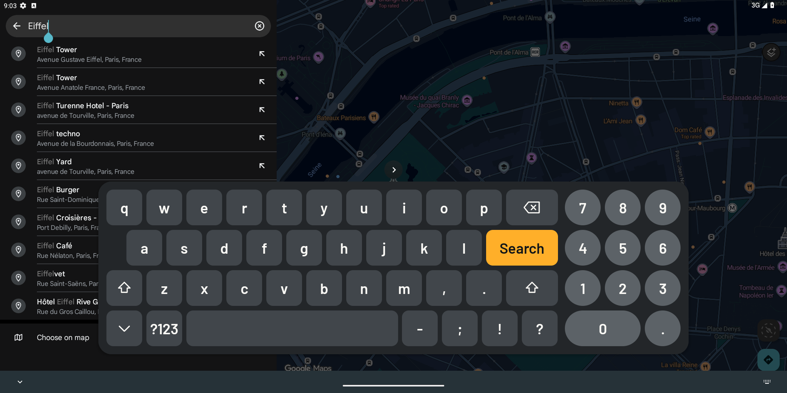

An offline Android keyboard for landscape head units, built on HeliBoard. The number pad stays beside the letters so you can enter a street number without switching layouts. Tap the down chevron to close the keyboard or `?123` to open symbols.

## Install

[Download Headunit Keyboard 0.2.11 for ARM64 and ARMv7](https://github.com/askAguilr/HeadunitKeyboard/releases/download/v0.2.11/HeadunitKeyboard-0.2.11.apk) · [All releases](https://github.com/askAguilr/HeadunitKeyboard/releases)

The same signed APK works on 64-bit ARM (`arm64-v8a`) and 32-bit ARM (`armeabi-v7a`). Android picks the matching libraries during installation. The APK also includes x86 and x86-64 for emulators. Requires Android 5.0 or later. Sign in with an account that has access to this private repository to download from GitHub.

Install the APK, open **Headunit Keyboard**, and follow the prompts to enable it and select it as your input method. To update an existing installation, install the new APK over it.

## Keyboard gallery

### In Google Maps

Google Maps is centered on the Eiffel Tower in Paris. On the 13-inch display, the map is visible beside the floating keyboard. On the 9-inch display, the keyboard spans the full width.

| 13-inch floating | 9-inch full width |
| --- | --- |
| [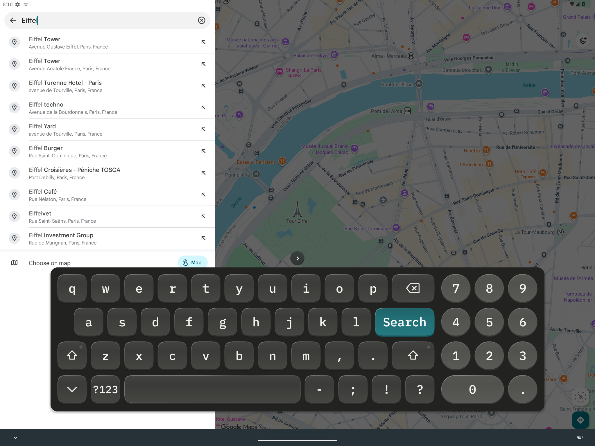](docs/screenshots/maps-13.png) | [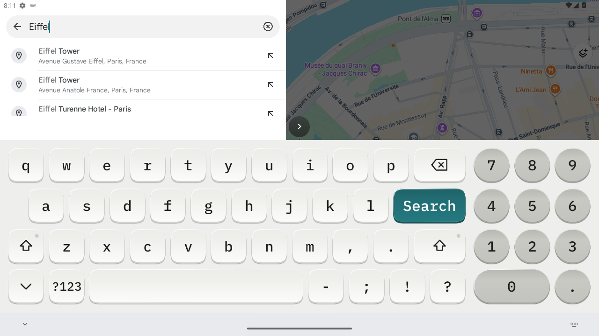](docs/screenshots/maps-9.png) |

Each pair below shows the same keyboard on two landscape displays. The 13-inch screen is 2048 × 1536 (4:3), and the 9-inch screen is 1280 × 720 (16:9). Select a screenshot to see the keys at their captured resolution.

### RetroDrive

RetroDrive has molded keycaps and a small lamp on each Shift key. The 13-inch captures show both lamps lit in the selected accent. The 9-inch captures show them off. The keys have an ivory finish in light mode and a charcoal finish in dark mode. RetroDrive follows Android while keeping your selected accent.

| Android appearance | 13-inch | 9-inch |
| --- | --- | --- |
| RetroDrive light | [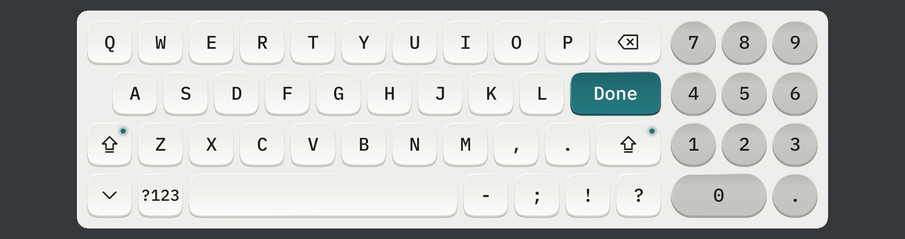](docs/screenshots/retrodrive-light-13.png) | [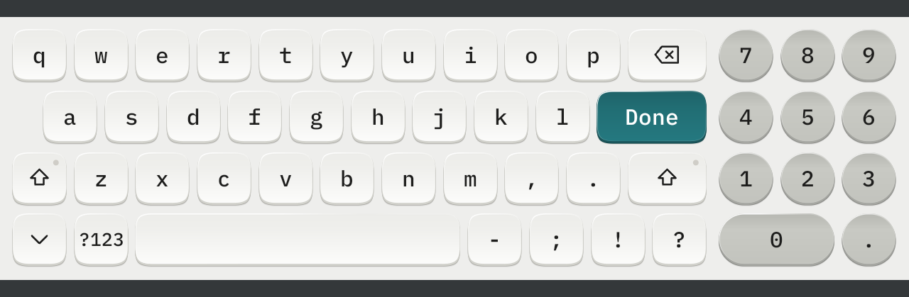](docs/screenshots/retrodrive-light-9.png) |
| RetroDrive dark | [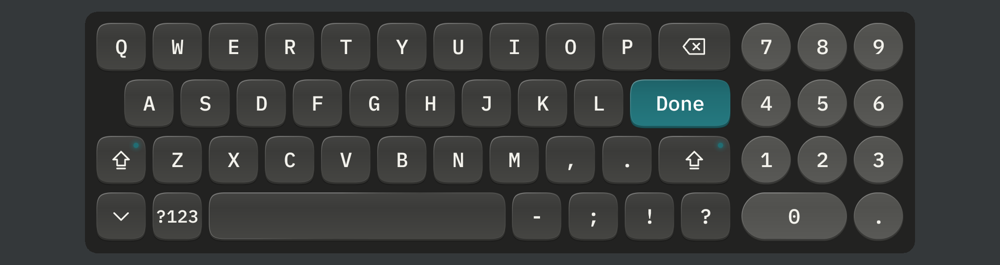](docs/screenshots/retrodrive-dark-13.png) | [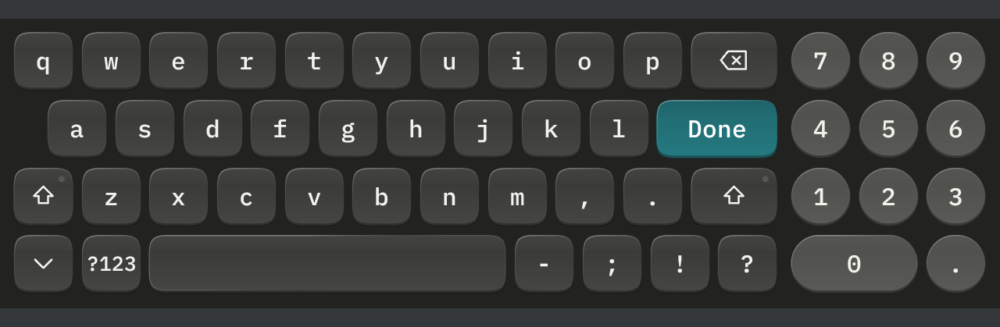](docs/screenshots/retrodrive-dark-9.png) |

### Standard keyboard

Choose **Follow system day and night** in the theme store to use Porcelain in light mode and Graphite in dark mode.

| Theme | 13-inch | 9-inch |
| --- | --- | --- |
| Porcelain | [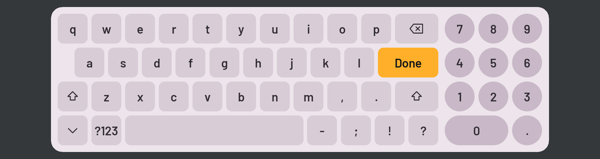](docs/screenshots/standard-light-13.png) | [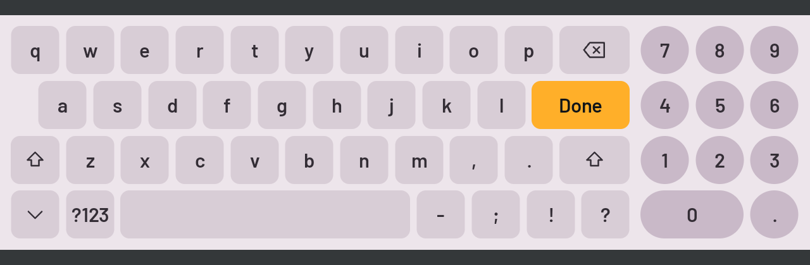](docs/screenshots/standard-light-9.png) |
| Graphite | [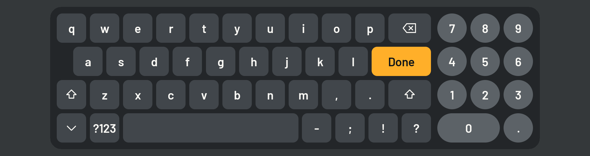](docs/screenshots/standard-dark-13.png) | [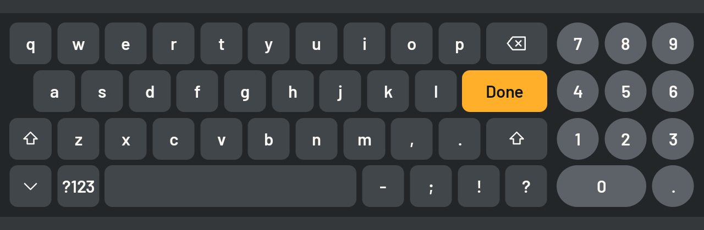](docs/screenshots/standard-dark-9.png) |

The eight keyboard-only captures use the automatic size setting and show the keyboard on a solid background. The side margins preserve its position on each display.

## Typing and appearance

| Feature | Details |
| --- | --- |
| Layout | Staggered letter rows, Shift on both sides, a separate backspace key and a wide zero. The action key follows the text field (Search, Done, Next). |
| Suggestions | The chevron sits in a circle when the strip is empty. It expands for words, clipboard suggestions or the toolbar. Apps can disable suggestions for individual fields. |
| Languages | Bundled dictionaries, dictionary import, gesture typing, autocorrect and Android spell checking. In the Spanish landscape QWERTY layout, hold N for ñ. |
| Clipboard and emoji | Clipboard history, pinned clips, emoji search and categories. |
| Themes | Choose Midnight, Graphite, Porcelain or RetroDrive in **Theme store**. The system setting uses Porcelain by day and Graphite at night. RetroDrive has molded keys, Spec Mono lettering and its own action-key accent. |
| Sound | A soft tap for letters, a lower pitch for backspace and a deeper spacebar sound. |

## Build

Use JDK 17, Android SDK 36 and NDK 29.0.14206865. Run `./gradlew :app:assembleRelease` (Windows: `gradlew.bat :app:assembleRelease`). Gradle writes the unsigned APK to `app/build/outputs/apk/release/`. Updates to the distributed build must use the same release signing key.

## Credits and licenses

- [HeliBoard 3.9](https://github.com/HeliBorg/HeliBoard/tree/98932242f54b3da14618eb81a90cd9f8eda10f84) supplies the input engine, layouts, dictionaries, settings and spell checker. The upstream source notices and license files are included.
- Gesture typing uses the separate proprietary OpenBoard binaries described in [HeliBoard’s glide typing documentation](https://github.com/HeliBorg/HeliBoard/wiki/FAQ#how-to-enable-glide-typing).
- The key sounds use the synthesis parameters for [TypeUI’s Soft thud](https://www.typeui.sh/ui-sounds/toggles). The generator is in `tools/render_sounds.py`.
- The RetroDrive theme uses molded buttons adapted from [Shu Ding's Hardware design](https://spec-01.vercel.app/). The bundled [Spec Mono](app/src/main/assets/retrodrive/OFL.txt) and [Barlow](app/src/main/assets/font/OFL.txt) fonts include their SIL Open Font License notices.
